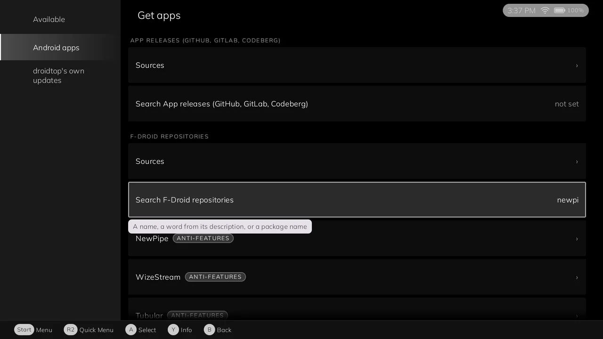

<h1 align="center">F-Droid repositories for droidtop</h1>

  <b>Browse, install and update Android apps from F-Droid repositories.</b> 
  Every index is checked against its signing key, and droidtop checks each app before Android installs it.

  
  
  
  

  

  <a href="#what-it-does">What it does</a> ·
  <a href="#install">Install</a> ·
  <a href="#status">Status</a> ·
  <a href="#for-developers">For developers</a> ·
  <a href="#licence">Licence</a>

An app catalog plugin for [droidtop](https://github.com/Droidtop/droidtop). You add the F-Droid repositories you want, and droidtop draws the search, the app pages and the updates. This plugin only reads the repositories.

## Install

You need [droidtop](https://github.com/Droidtop/droidtop). Repositories are not added for you, so start by adding one.

1. In droidtop open **Settings > Plugins > Add**. droidtop's own catalog is always there.
2. Pick **F-Droid repositories** and press **Install**.
3. Read the permissions it asks for and press **Accept**. Nothing runs until you do.

You can also browse the catalog at [droidtop.github.io](https://droidtop.github.io/), or open this plugin's install page directly: [Install in droidtop](https://droidtop.github.io/install-plugin?catalog=https%3A%2F%2Fraw.githubusercontent.com%2Fdroidtop%2Fdroidtop-platforms%2Fmain%2Fdroidtop-plugins%2Findex.json&id=droidtop.fdroid). That link only opens a review inside droidtop.

## What it does

- **Repositories.** None is configured by default. The person adds one by an F-Droid
  repository link (`fdroidrepos://...`, `https://fdroid.link/#...`, an `https://.../fdroid/repo`
  address, routed to this plugin by droidtop's link router), a QR code, an address with its
  fingerprint, or with a press from the repositories F-Droid's own client lists (F-Droid,
  IzzyOnDroid, Guardian Project, microG, NewPipe, Briar; addresses and fingerprints as
  F-Droid's client pins them). Each is shown for review (its name, address, the fingerprint of
  its signing key and whether the link vouched for it) and added only on Accept.
- **Verification**, F-Droid's own rules: `entry.jar` signed by exactly one certificate, which
  must be the one pinned when the repository was added (or the fingerprint the link named);
  the index must match the SHA-256 the signed entry names; an older index than the one held is
  refused.
- **Apps.** Search, an app's page (description, licence, links, anti-features with the
  repository's reasons, signing keys, versions) and the newest compatible version of every app
  (stable channel, the device's Android version and ABIs) for droidtop's Updates. droidtop
  compares those with the installed apps itself; this plugin is never told what is installed.
- **Installing.** `acquire` returns the APK's address in the repository, its SHA-256 and size,
  and the package name, version code and signing-key SHA-256s the APK must have; droidtop
  downloads it as a Downloads job and refuses anything else before Android sees it.

## Status

Not built yet: diff indexes (a changed index is fetched whole), repository mirrors for downloads, icons and
screenshots, a scheduled refresh, release channels other than stable, plain-http (`fdroidrepo://`)
repositories (droidtop's network broker allows https only outside the local network).

## For developers

A droidtop plugin (`native_bundle`, contract 2, contained) that is an **app catalog**
(`apps.catalog@1`, droidtop `docs/plugin-api.md` 3 A12): it reads F-Droid repositories the
person adds, and droidtop draws everything, downloads, checks and installs
(droidtop `docs/SPEC.md` 10b "Installing apps", Droidtop/tracker#261).

### Upstream

The F-Droid code is F-Droid's own index library, `org.fdroid:index` (gitlab.com/fdroid/fdroidclient,
`libs/index`, Apache-2.0), chosen on Droidtop/tracker#261 over Droid-ify and Neo Store because it is the
reference implementation and the only one published as a library. `prepare.sh` pins it by version and
SHA-256; to take upstream's fixes, bump both. The plugin parses with upstream's
`IndexV2FullStreamProcessor` and models. Two pieces are rewritten here because upstream's take a
`java.io.File` or `android.net.Uri` and a contained plugin has neither: `EntryJar` (upstream
`EntryVerifier`/`JarIndexVerifier`, the same checks on a `JarInputStream`) and `RepoLinks` (upstream
`RepoUriGetter`'s rules). A stream-based entry verifier is the change to offer upstream.

### Files

- `src/dev/droidtop/plugins/fdroid/`: `FdroidPlugin` (the calls), `Indexer` (fetch and verify),
  `Catalog` (search, app, latest, acquire), `Store` (the plugin's data files), `EntryJar`, `RepoLinks`,
  `Host` (the broker calls: `net.http`, `net.download`, `data.open`).
- `manifest.template.json`: everything but `payload`. Permissions: `net.any` (repositories can be on
  any site), `intents.in` (repository links).
- `prepare.sh`, `build.sh`, `rules.pro`: fetch and pin the libraries, compile, shrink and move the
  bundled libraries under `dev.droidtop.plugins.fdroid.lib` with R8, hash.
- `sign.sh`: signs with the origin key in CI (`PLUGIN_SIGNING_KEY`, `PLUGIN_SIGNING_CERT`).

## Licence

GPL-3.0, see [LICENSE](LICENSE) and [NOTICE](NOTICE). The F-Droid index library it builds on is Apache-2.0.

## Signing

The bundle carries `manifest.jws`: a detached ES256 JWS over the exact bytes of `manifest.json`, with this repository's leaf certificate in `x5c` (the root itself is not included). The leaf comes from the repository secrets `PLUGIN_SIGNING_KEY` and `PLUGIN_SIGNING_CERT` and was issued by the droidtop root (pinned by the droidtop app); it names the plugin's origin and id. `sign_jws.py` writes the signature and checks it against the leaf before packing. `manifest.sig` stays in the bundle for older droidtop builds. Expiry dates are not checked.
